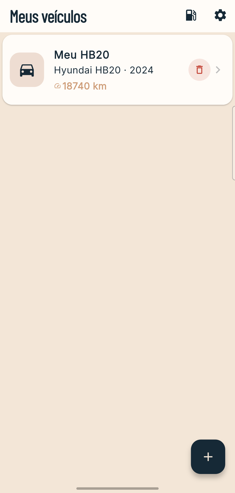
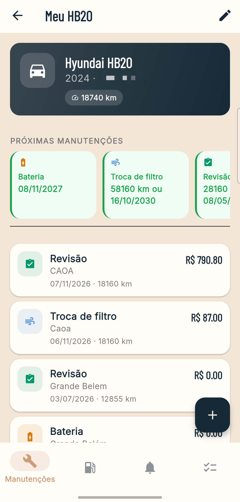
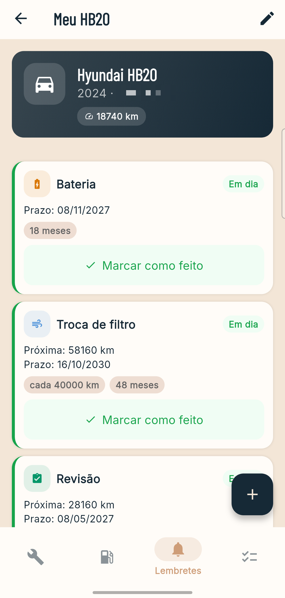
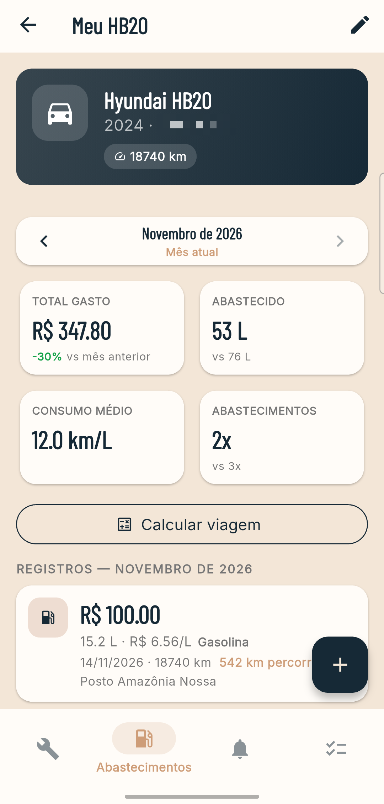
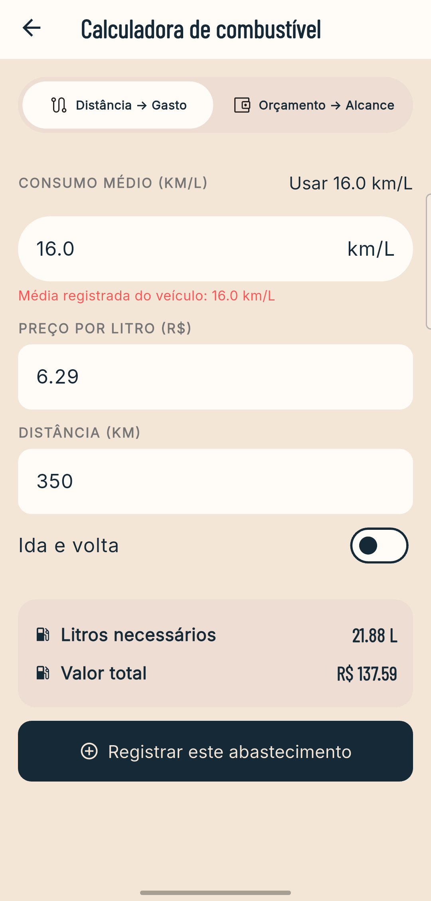

# RevisarCar

App Android para controlar a manutenção dos seus veículos (carros e motos): manutenções, lembretes, abastecimentos e checklist, com os dados salvos na nuvem.

## Download

Baixe o APK da versão mais recente na página de [Releases](https://github.com/jeancarloscc/revisarcar/releases/latest).

1. Em **Assets**, baixe o arquivo `.apk`.
2. Abra o arquivo no celular. Se o Android pedir, permita instalar apps dessa fonte.
3. Entre com sua conta Google.

Para receber as atualizações automaticamente, use o [Obtainium](https://github.com/ImranR98/Obtainium) com o link deste repositório.

**Requisitos:** Android 7.0 ou superior e uma conta Google.

## Funcionalidades

- **Veículos:** cadastre carros e motos com modelo, ano, placa e quilometragem.
- **Manutenções:** registre revisões, trocas de óleo e filtro, pneus, bateria e outros serviços, com valor e oficina.
- **Lembretes:** receba avisos por quilometragem ou por data. Ao registrar uma manutenção, o próximo lembrete é criado automaticamente com base nos intervalos do veículo.
- **Notificações:** os lembretes viram notificações no celular, mesmo com o app fechado.
- **Abastecimentos:** acompanhe gastos e consumo (km/L) organizados por mês, com comparação com o mês anterior.
- **Calculadora de combustível:** calcule quanto vai gastar numa viagem ou até onde vai com o dinheiro que tem.
- **Checklist:** monte sua lista de verificação do veículo ou use a lista sugerida.
- **Tema escuro.**

## Capturas de tela

| Veículos | Manutenções | Lembretes | Abastecimentos | Calculadora |
|---|---|---|---|---|
|  |  |  |  |  |

## Privacidade

Os dados ficam no Firebase, ligados à sua conta Google. As regras de segurança do banco ([`firestore.rules`](firestore.rules)) permitem que cada usuário leia e altere apenas os próprios dados: ninguém mais tem acesso a eles.

## Para desenvolvedores

### Stack

- **Flutter** (Dart `^3.12.2`)
- **Gerenciamento de estado:** `provider`
- **Backend:** Firebase (`firebase_auth` + `google_sign_in`, `cloud_firestore`)
- **Notificações:** `flutter_local_notifications` + `timezone`
- `shared_preferences`, `google_fonts`, `flutter_localizations`

### Como rodar

1. Instale as dependências:
   ```
   flutter pub get
   ```
2. Rode os testes, que não precisam do Firebase:
   ```
   flutter test
   ```
3. Para rodar o app com login, crie um projeto Firebase próprio, ative o login com Google e configure com:
   ```
   flutterfire configure
   ```
   O login com Google do projeto original só aceita as chaves cadastradas nele, por isso é preciso um projeto próprio. Também cadastre no Firebase o SHA-1 da sua chave de debug.
4. Rode o app em um dispositivo ou emulador Android:
   ```
   flutter run
   ```

## Contribuindo

Contribuições são bem-vindas! Leia o [guia de contribuição](CONTRIBUTING.md) antes de abrir um pull request.

## Licença

Copyright (C) 2026 Jean Carlos

Este projeto é distribuído sob a licença [GNU GPL v3.0](LICENSE).
